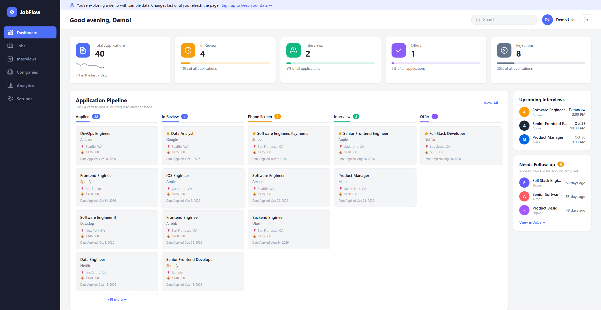
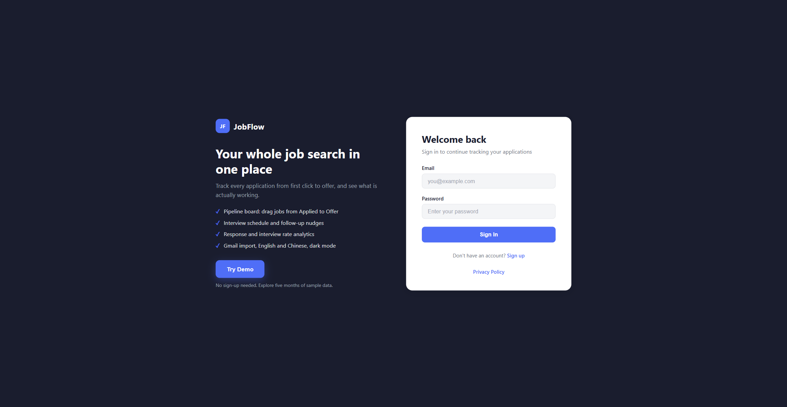
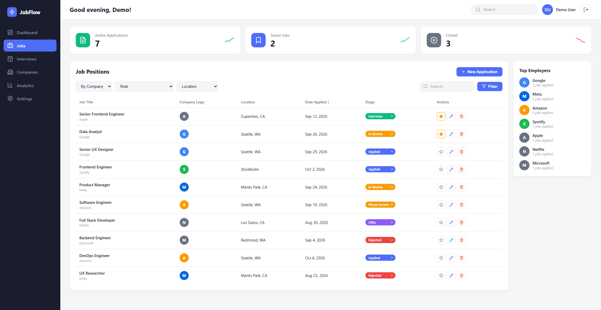
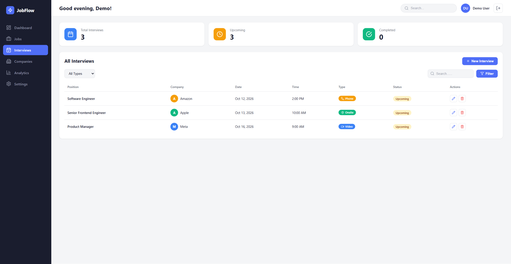
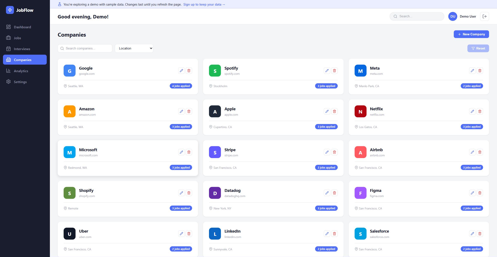
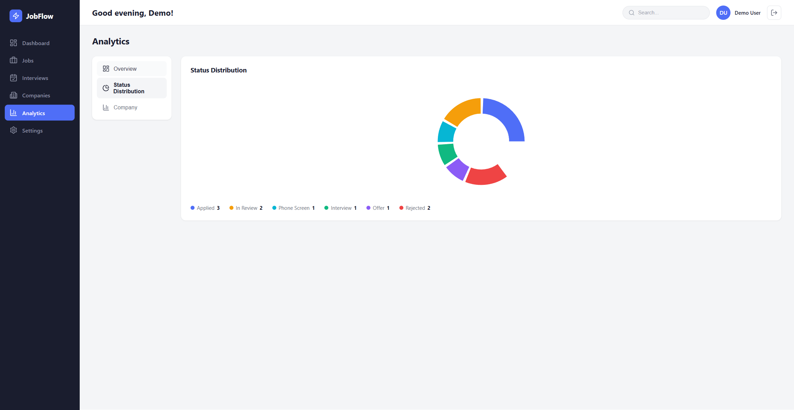
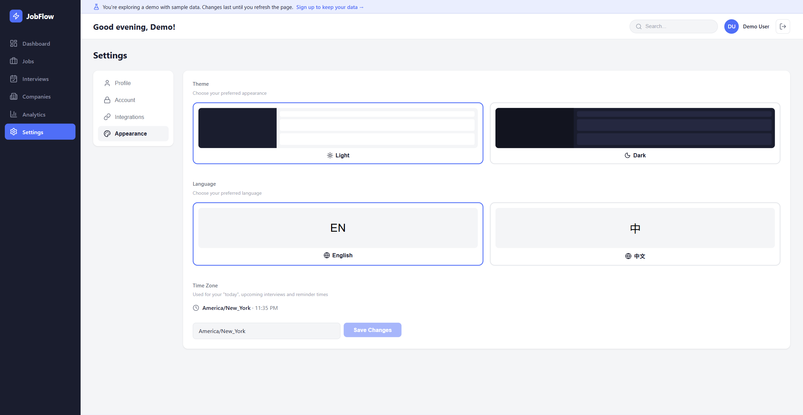
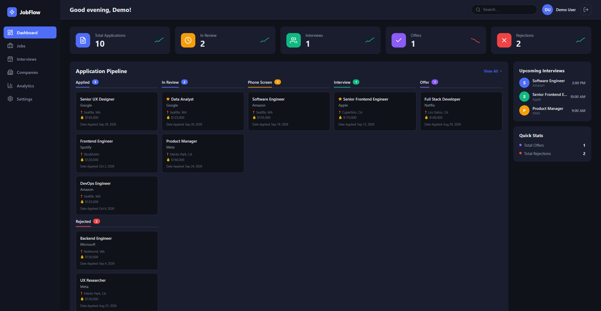

# JobFlow


A full-stack job application tracker with JWT + OAuth2 authentication, Kanban pipeline, interview management, and analytics dashboard.

## Screenshots

<a href="docs/dashboard.png"></a>

<table>
  <tr>
    <td align="center"><strong>Login</strong><br><a href="docs/login.png"></a></td>
    <td align="center"><strong>Jobs</strong><br><a href="docs/jobs.png"></a></td>
  </tr>
  <tr>
    <td align="center"><strong>Interviews</strong><br><a href="docs/interviews.png"></a></td>
    <td align="center"><strong>Companies</strong><br><a href="docs/companies.png"></a></td>
  </tr>
  <tr>
    <td align="center"><strong>Analytics</strong><br><a href="docs/analytics.png"></a></td>
    <td align="center"><strong>Settings</strong><br><a href="docs/settings.png"></a></td>
  </tr>
  <tr>
    <td align="center"><strong>Dark Mode</strong><br><a href="docs/dashboard-dark.png"></a></td>
    <td></td>
  </tr>
</table>

> *Click any screenshot to view full resolution.*

## Tech Stack

| Frontend | Backend | Database |
|----------|---------|----------|
| React 19, TypeScript, Vite | Java 21, Spring Boot 3, Spring Security | MySQL 8, Flyway migrations |
| Axios, Recharts, React Router | JWT (HS256), Google/GitHub OAuth2 | Hibernate, Spring Data JPA |
| Vitest, React Testing Library | JUnit 5, MockMvc, Mockito, Testcontainers | |

## Features

- **Auth** — Register/login with JWT, Google & GitHub OAuth2, demo mode
- **Dashboard** — Stat cards, Kanban pipeline, recent applications (starred first), upcoming interviews
- **Jobs** — Searchable, paginated application table with a quick status dropdown, starred (saved) jobs, and top employers
- **Interviews** — Schedule and manage interviews linked to applications, with optional email reminders
- **Companies** — Company directory with search and per-company application count
- **Gmail import** — Connect Gmail, scan for application emails, and import them as applications
- **Analytics** — Overview, status distribution, per-company breakdown
- **Global search** — Search applications and companies from the top bar
- **Settings** — Profile, password, theme (dark/light), language (English/中文), and time zone

## Getting Started

### Configuration

The backend reads its settings from environment variables. Copy `.env.example`
to `.env` and fill it in:

| Variable | Required | What it's for |
|----------|----------|---------------|
| `DB_USERNAME`, `DB_PASSWORD` | Yes | MySQL login |
| `JWT_SECRET` | Yes | Signs login tokens (at least 32 characters) |
| `DB_HOST`, `DB_PORT` | No | MySQL address, default `localhost:3306` |
| `MAIL_USERNAME`, `MAIL_PASSWORD` | No | Gmail SMTP for interview reminder emails |
| `SEED_DEMO_DATA` | No | `true` creates a sample account `demo@jobflow.com` / `demo123` on startup. Default `false`; keep it off anywhere public |
| `GOOGLE_CLIENT_ID`, `GOOGLE_CLIENT_SECRET` | No | Google sign-in and Gmail import |
| `GITHUB_CLIENT_ID`, `GITHUB_CLIENT_SECRET` | No | GitHub sign-in |

The app works without the optional ones; those features are just turned off.

### Option A: Docker (everything in one go)

Needs Docker. With `.env` in the repo root:

```bash
git clone https://github.com/jianweicheng0822/JobFlow.git
cd JobFlow
docker compose up -d --build
```

Open http://localhost. MySQL is exposed on port 3307.

### Option B: Run locally

Needs Node.js 20+, Java 21+ and MySQL 8+. Create the database first; Flyway
creates the tables on first start.

```bash
# 1. Clone
git clone https://github.com/jianweicheng0822/JobFlow.git
cd JobFlow

# 2. Database
mysql -u root -p -e "CREATE DATABASE jobflow;"

# 3. Backend (starts on :8080)
cd job-flow-backend
./mvnw spring-boot:run

# 4. Frontend (starts on :5173)
cd ../job-flow-frontend
npm install && npm run dev
```

For a local run, set the variables above as environment variables, or put a
`.env` file in `job-flow-backend/`. If you only run MySQL from Docker
(`docker compose up -d mysql`), set `DB_PORT=3307`.

On Windows, `start.bat` starts the backend and frontend in two windows.

> **Demo Mode:** Click "Try Demo" on the login page to explore with mock data, no backend needed.

## API Endpoints

All endpoints except `/api/auth/**` require `Authorization: Bearer <token>`.

| Resource | Endpoints |
|----------|-----------|
| **Auth** | `POST /register`, `POST /login`, `GET /me`, `PUT /profile`, `PUT /password`, `PUT /time-zone` |
| **Applications** | `GET /`, `GET /page`, `GET /{id}`, `POST /`, `PUT /{id}`, `PATCH /{id}/status`, `PATCH /{id}/star`, `DELETE /{id}`, `DELETE /batch`, `GET /stats`, `GET /recent`, `GET /activity`, `GET /export` |
| **Interviews** | `GET /`, `GET /{id}`, `GET /upcoming`, `POST /`, `PUT /{id}`, `DELETE /{id}` |
| **Companies** | `GET /`, `GET /{id}`, `POST /`, `PUT /{id}`, `DELETE /{id}` |
| **Gmail** | `GET /status`, `GET /link`, `GET /callback`, `POST /scan`, `POST /import` |

Base paths: `/api/auth`, `/api/applications`, `/api/interviews`, `/api/companies`, `/api/gmail`

## Testing

About **390 tests**: backend integration and unit tests, frontend component and API tests.

```bash
# Backend (needs Docker running: integration tests start MySQL with Testcontainers)
cd job-flow-backend && ./mvnw test

# Frontend
cd job-flow-frontend && npx vitest run
```

## Load Testing

The backend was load tested with [k6](https://k6.io/) against 205 seeded users
and 17,000 applications, with a mix of 80% browsing, 15% editing and 5% logging in.
The limit is the highest rate where p95 stays under 500 ms and under 1% of
requests fail.

| Setup | Limit (iterations/s) | p95 at 80 it/s |
|-------|----------------------|----------------|
| Default (10 DB connections) | 70 | 1,903 ms |
| 20 DB connections | 90 | 90 ms |
| 20 DB connections + open-in-view off (current) | 80 | 102 ms |

Thread dumps showed 190 of 200 request threads waiting for a database connection,
which is what led to the larger pool. One iteration averages about 7 requests.
Everything (k6, backend, MySQL) ran on one laptop, so these numbers are for
comparing changes, not a production capacity figure.

How to run it yourself: [loadtest/README.md](loadtest/README.md).
